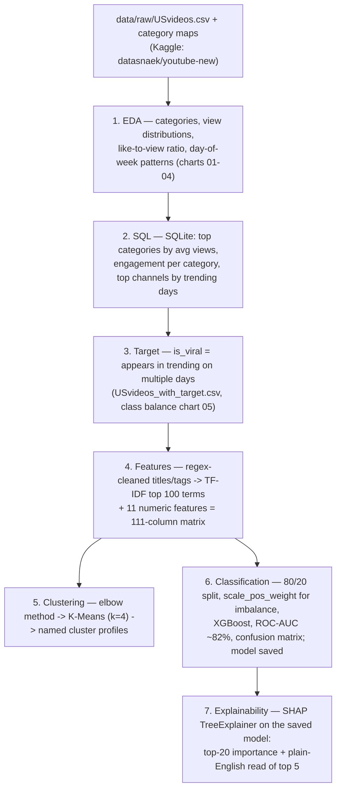

# YouTube Trending ML — Predicting Viral Content

NLP + ML pipeline over the **YouTube Trending** dataset (US subset, 48,697 trending-video rows): TF-IDF features from titles and tags, **K-Means clustering** of videos, an **XGBoost** classifier for viral content (**~82% AUC**), and **SHAP** explanations of what the model actually keys on.

**Author:** Suparna Deshmukh
**Stack:** Python · Jupyter · pandas · scikit-learn · XGBoost · SHAP · SQLite

**Live:** none — this is a local notebook pipeline (all artifacts below are committed in `outputs/`).

## System design



## Results (from committed `outputs/`)

**Four video clusters** (`outputs/reports/cluster_summary.csv`):

| Cluster | Videos | Avg views | Viral rate |
|---------|-------:|----------:|-----------:|
| 💜 Engaged Community | 10,778 | 1.45 M | 97.4 % |
| 📺 Standard Trending | 29,289 | 1.65 M | 95.0 % |
| 🔥 Mainstream Hits | 808 | 31.2 M | 99.4 % |
| 🚀 Viral Giants | 74 | 99.2 M | 100 % |

**XGBoost classifier:** ~82 % ROC-AUC on the 20 % holdout with class-imbalance handling (`outputs/models/xgboost_viral_classifier.pkl`).

**SHAP** says the model leans on topical keywords first — `audio`, `ft`, `youtube`, `science`, `interview` — i.e. *what a video is about* (and its niche) drives virality more than raw engagement metrics.

## How to run

```bash
python -m venv ml-env && source ml-env/bin/activate
pip install pandas numpy matplotlib seaborn scikit-learn xgboost shap joblib
jupyter notebook Notebook.ipynb
```

Run top to bottom — every cell is commented in plain English. If a cell references an absolute path, repoint the single `data_path` line at your copy of `data/`.

## Repository layout

```
Notebook.ipynb                    # the full 7-stage pipeline (70 commented cells)
charts/                           # 01-10, every figure in the report
data/raw/                         # USvideos.csv + category id maps (US subset)
data/processed/                   # USvideos_with_target.csv (ready-to-model frame)
outputs/models/xgboost_viral_classifier.pkl
outputs/reports/                  # SQL query results, cluster summary, SHAP table
YouTube_Trending_ML_Report.pdf    # full write-up
```

Data: [datasnaek/youtube-new on Kaggle](https://www.kaggle.com/datasets/datasnauk/youtube-new) (free, no API key). The other 10 country CSVs (~600 MB) are intentionally not committed; the SQLite DB is rebuilt by the notebook cell "LOAD DATAFRAME INTO SQLITE".
